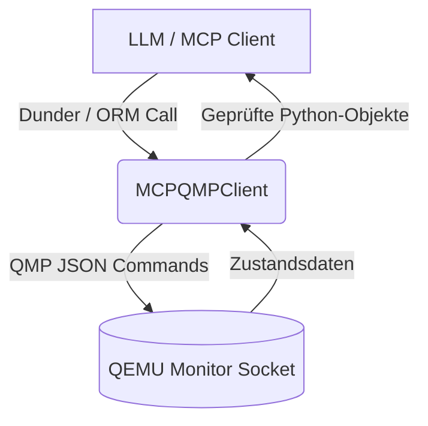

# MCP2QMP 🚀

[](https://www.python.org/)
[](https://opensource.org/licenses/MIT)
[]()

> **Bridging Model Context Protocol (MCP) with QEMU Monitor Protocol (QMP).**  
> Steuere virtuelle Maschinen und analysiere QEMU-Zustände über eine saubere, Python-native Dunder-DSL oder ORM-Strukturen – ohne Boilerplate-Code.

---

## 🏗️ Architektur & Funktionsweise

MCP2QMP schichtet sich zwischen den Aufrufer (z. B. ein LLM via MCP) und den rohen QMP-Socket von QEMU:



---

## 💡 Warum MCP2QMP?

Wenn man direkt mit dem QEMU Monitor Protocol arbeitet, stößt man schnell auf typische Hürden:

* **Repetitives JSON-Handling:** Ständiges Parsen von Dictionaries und Sockets.
* **Manuelle Pfad- und Strukturkenntnisse:** Unübersichtliche QMP-Befehlsketten.
* **Fehlende Abstraktion:** Schwer lesbare Query-Logik im Anwendungscode.

MCP2QMP löst das durch eine flüssige Abfrageschicht.

---

## 🌟 Kernkonzepte

### 1. QMPPathProxy & Dunder-DSL

Die Klasse `QMPPathProxy` ermöglicht den intuitiven Aufbau von Abfragen über Python-Magie:

* **Attribute:** `client.q.status.running`
* **Indizes:** `client.q.cpu[0]`
* **Schlüssel:** `client.q['status']['running']`

### 2. Query-API

Die zentrale Laufzeitlogik sitzt in `MCPQMPClient.query_path()`. QMP-Daten werden abgefragt und transparent über JSONPfade ausgewertet.

### 3. Optionales ORM-Verhalten

Vorbereitet für objektorientiertes Mapping:

```python
client.vm.status.running
client.vm.devices.cpu[0]

```

---

## ⚡ Schnellstart

### Voraussetzungen

* Python 3.10+
* Eine laufende QEMU-Instanz mit aktivem QMP-Socket (z. B. Unix-Socket unter `/tmp/qmp.sock`)

### Installation & Beispiel

```python
from MCP2QMP import MCPQMPClient

# Client mit dem QMP-Socket verbinden
client = MCPQMPClient("/tmp/qmp.sock")

# 1. Einfachen Status abfragen
status = client.q.status()
print("QEMU Status:", status)

# 2. Pfadabfrage über die Dunder-DSL
is_running = client.q.status.running()
print("Running:", is_running)

# 3. Zugriff auf spezifische CPU-Threads
thread_id = client.q.cpu[0].pcpu[0].thread_id()
print("CPU Thread ID:", thread_id)

```

---

## 🛠️ Mitwirken (Contributing)

Pull Requests und Issues sind herzlich willkommen! Schau dir gerne die offenen Issues an oder reiche einen PR ein, um das ORM-Verhalten weiter auszubauen.

## 📄 Lizenz

Veröffentlicht unter der [MIT License](https://www.google.com/search?q=LICENSE).

```

<FollowUp label="Möchtest du, dass ich dir eine passende `LICENSE`-Datei (MIT) oder eine `setup.py`/`pyproject.toml` für das Repository erstelle?" query="Erstelle mir eine pyproject.toml für das MCP2QMP-Projekt."/>

```
